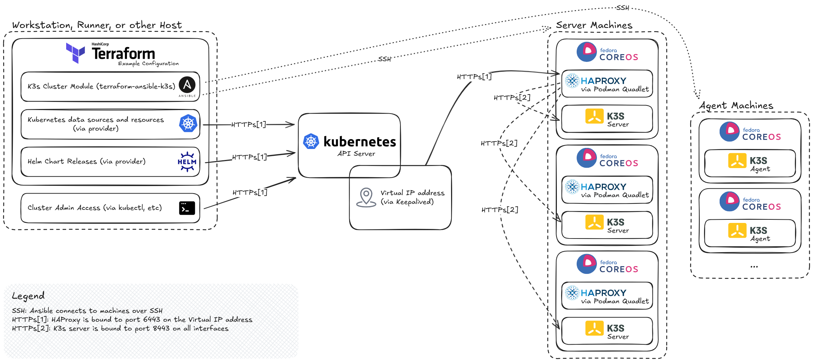

# K3s Cluster Terraform Module

[](https://registry.terraform.io/modules/marshallford/k3s/ansible/latest)
[](https://github.com/marshallford/terraform-ansible-k3s/releases)

Provision and operate a Kubernetes cluster with the convenience of a CSP-managed Kubernetes service. Designed for homelabs, on-premises, and edge environments.



## 📦 Features

1. **Deploys** [K3s](https://docs.k3s.io/), a single-binary Kubernetes distribution
2. **Employs** K3s' [air-gapped](https://docs.k3s.io/installation/airgap) installation method
3. **Implements** a virtual IP address with automatic failover for the Kubernetes API server (powered by [Keepalived](https://www.keepalived.org/))
4. **Delivers** a [highly available](https://docs.k3s.io/architecture#high-availability-k3s) control plane with load-balanced server nodes (powered by [HAProxy](https://www.haproxy.org/))
5. **Includes** built-in [SELinux support](https://docs.k3s.io/advanced#selinux-support) using the SELinux policy package
6. **Offers** curated [configuration options](https://docs.k3s.io/installation/configuration) including node taints/labels, cluster networking, and Kubernetes component flags
7. **Integrates** with K3s' [auto-deploying manifests](https://docs.k3s.io/installation/packaged-components#auto-deploying-manifests-addons) and [registry configuration](https://docs.k3s.io/installation/private-registry) features
8. **Provides** recommendations for [CIS hardening](https://docs.k3s.io/security/hardening-guide) via an optional Terraform submodule and [graceful node shutdown](https://kubernetes.io/docs/concepts/cluster-administration/node-shutdown/#graceful-node-shutdown) via a worked example
9. **Secures** the Kubernetes API server with a [structured authentication configuration file](https://kubernetes.io/docs/reference/access-authn-authz/authentication/#anonymous-authenticator-configuration) covering anonymous authenticator restrictions and JWT authenticators, delivered via an optional Terraform submodule
10. **Performs** in-place [upgrades](https://docs.k3s.io/upgrades/manual#upgrade-k3s-using-the-binary) with coordinated node draining and optional [system upgrades](https://coreos.github.io/rpm-ostree/)
11. **Manages** day-2 node additions and [removals](https://docs.k3s.io/installation/uninstall)
12. **Facilitates** Kubernetes certificate [rotation](https://docs.k3s.io/cli/certificate#checking-expiration-dates)
13. **Enables** seamless Terraform-native [cluster access](https://docs.k3s.io/cluster-access), no manual steps required
14. **Protects** machines with a default-deny [nftables](https://wiki.nftables.org/) host firewall that works with any CNI and accepts custom rules

## 🚀 Key Differentiators

1. **Cloud-agnostic by design** -- provisions clusters without dependencies on cloud services (e.g. Load Balancers, PKI, KMS)
2. **Day-2 friendly operations** -- avoids reliance on machine bootstrapping tools (e.g. Cloud-init, Ignition), simplifying troubleshooting and management at scale
3. **Self-contained architecture** -- eliminates the need for an external Ansible control plane (e.g. AWX/Ansible Tower)
4. **Open source** -- no paid tiers, proprietary unlocks, or per-node fees

## 📋 Requirements

### 🛠️ Terraform execution host/runner

1. [Terraform](https://developer.hashicorp.com/terraform/install) installed (version 1.15 or later)
2. [`ansible-navigator`](https://ansible.readthedocs.io/projects/navigator/installation/) installed (version 26.8.0 or later)
3. Container engine (`podman` or `docker`) with support for `amd64` or `arm64` images (Ansible execution environment)
4. Access to `github.com` to download K3s release artifact tarballs

### ⚙️ Machines (baremetal or virtual)

1. [Fedora CoreOS](https://fedoraproject.org/coreos/) 44 or later (`amd64`, `arm`, or `arm64` architecture)
2. Configured with a non-root [user](https://docs.fedoraproject.org/en-US/fedora-coreos/authentication/) with passwordless `sudo` access
3. Reachable via SSH from the Terraform execution host/runner
4. Network connectivity between all machines
5. Python 3 installed on the [host](https://docs.fedoraproject.org/en-US/fedora-coreos/os-extensions/) (required by Ansible)
6. Access to `quay.io` and the [Fedora repositories](https://docs.fedoraproject.org/en-US/quick-docs/fedora-repositories/) (via direct internet access, a configured proxy, or local mirror/container registry) for system upgrades and package downloads. Note: Using Zincati for automatic updates requires additional access

## 🔍 Example

Additional [examples](/examples) available. Note that they reference the module by relative path (`source = "../../"`) so they can be validated against the working tree -- substitute the registry source and version shown below when copying one.

```terraform
module "k3s" {
  source  = "marshallford/k3s/ansible"
  version = "0.8.0" # x-release-please-version

  ssh_private_keys = [
    {
      name = "example"
      data = var.private_key
    }
  ]

  api_server = {
    virtual_ip        = "192.168.1.99"
    virtual_router_id = 1
  }

  tokens = {
    server = "some-token"
    agent  = "some-token"
  }

  server_machines = {
    machines = { for name, addr in local.server_machines : name => {
      name    = name
      address = addr
    } }
  }

  agent_machine_groups = {
    "example" = {
      machines = { for name, addr in local.agent_machines : name => {
        name    = name
        address = addr
      } }
    }
  }
}

provider "kubernetes" {
  host                   = module.k3s.server
  cluster_ca_certificate = module.k3s.ephemeral_credentials.cluster_ca_certificate
  client_certificate     = module.k3s.ephemeral_credentials.client_certificate
  client_key             = module.k3s.ephemeral_credentials.client_key
}
```

## 🔒 Security Considerations

1. **State file sensitivity** -- if `kubeconfig_block_type` is set to `data` or `resource`, the cluster admin kubeconfig will be persisted in both Terraform's state file and any generated plan files. These files should be treated as sensitive and protected accordingly.
2. **Certificate management** -- Kubernetes certificates are rotated as needed on module apply, but it is the operator's responsibility to re-run Terraform before they expire. See the [K3s certificate docs](https://docs.k3s.io/cli/certificate) for details.
3. **CIS Kubernetes benchmark** -- many controls are satisfied by default in K3s or via the provided `cis-hardening` submodule. Controls outside this scope remain the operator's responsibility.
4. **Machine updates** -- use Zincati for automatic updates or configure `system_upgrade_trigger` for coordinated updates and reboots through this module.
5. **Access control** -- exposing machines or the Kubernetes API server directly to the internet increases risk. Access should be restricted through VPN, bastion, or firewall controls.
6. **Host firewall** -- each machine drops inbound traffic except SSH, ICMP, NodePorts, the API server (servers only), cluster nodes, the pod network, and the service network. Add rules with `firewall_rules` on `server_machines` or an agent group. The last matching rule wins. For example, `["tcp dport 22 drop", "ip saddr 192.0.2.0/24 tcp dport 22 accept"]` limits SSH to one network, which must include the Terraform runner. `["accept"]` disables filtering. A CNI that assigns pod addresses outside `cluster_cidr` needs a rule accepting them.

## 🔐 Supply Chain

The Ansible execution environment image is built and published by the [release workflow](.github/workflows/release.yaml). Every published image is signed with [cosign](https://docs.sigstore.dev/cosign/signing/overview/) (keyless, via the workflow's OIDC identity) and carries SLSA build provenance and an SPDX SBOM as attestations stored alongside it in the registry. Version tags (`vX.Y.Z`) are never overwritten, the release workflow refuses to publish over one, while `latest` moves with each release.

```shell
make verify VERIFY_CONTAINER_IMAGE=ghcr.io/marshallford/terraform-ansible-k3s:v0.8.0 # x-release-please-version
```

`verify/image` checks that the image was produced by the release workflow, via both a Sigstore bundle in the registry and GitHub's provenance attestation. `verify/sbom` checks the SBOM attestation. Run `make -n verify` to print the underlying `cosign` and `gh attestation verify` invocations, which require [`cosign`](https://docs.sigstore.dev/cosign/system_config/installation/) and [`gh`](https://cli.github.com/). Each [release](https://github.com/marshallford/terraform-ansible-k3s/releases) also carries a package-level SBOM, the published image digest, and the generated build context (`Dockerfile` plus the `ansible-builder` scripts it executes, sufficient to rebuild the image). The image itself carries a fuller SBOM that also inventories every file.

## ⚠️ Limitations

1. Only tested with `amd64` machines
2. IPv4 only (no dual-stack or IPv6-only clusters)
3. SELinux package cannot be upgraded ([upstream issue](https://github.com/coreos/rpm-ostree/issues/2127))
4. Machines removed must be fully wiped or have their disks reprovisioned prior to rejoining the cluster
5. Terraform-managed machine resources and their dependencies are always `create_before_destroy`, so a replacement can't reuse the old machine's fixed-name resources or static IP address
6. A replaced machine needs a new `name`; the old machine is only reset when its `name` is removed

## 🚧 To-do

- [ ] Port the Butane snippets to Ansible roles, including installing Python
- [ ] Add a Butane snippet for NTP
- [ ] Run custom Ansible plays (pre, post, etc.)
- [ ] Support single-server clusters and external load balancers without keepalived
- [ ] Support dual-stack networking
- [ ] Rotate the K3s tokens
- [ ] Keep join tokens out of Terraform state
- [ ] Handle replaced machines that reuse an IP address (stale SSH host keys)
- [ ] Block changes to critical K3s settings after cluster creation
- [ ] Allow repeated component flags and taint keys
- [ ] Check the minimum podman version
- [ ] Coordinate Zincati reboots with playbook runs and across nodes (FleetLock)
- [ ] Prune unused container images
